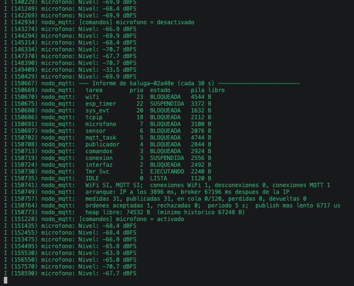
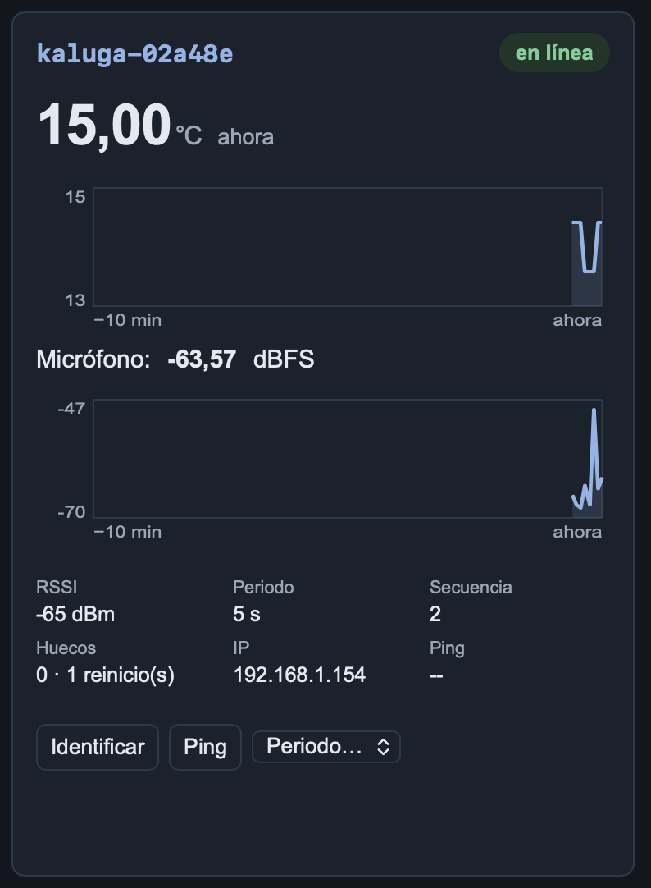
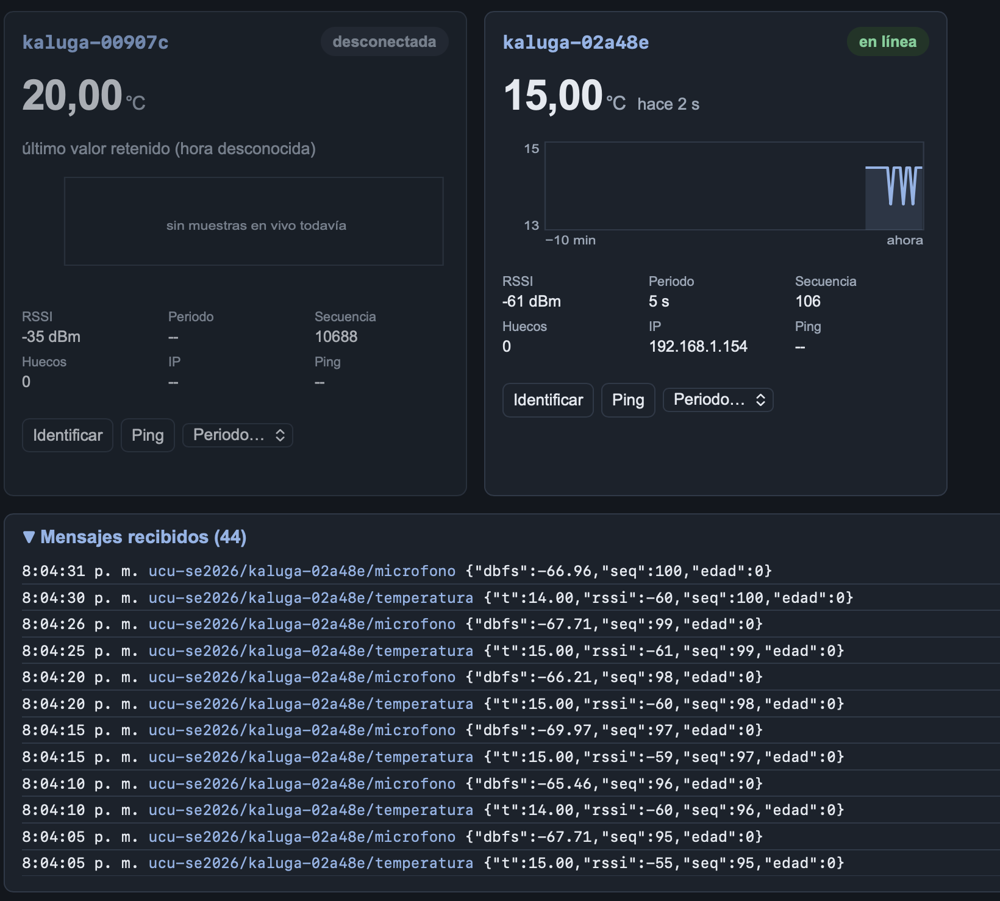
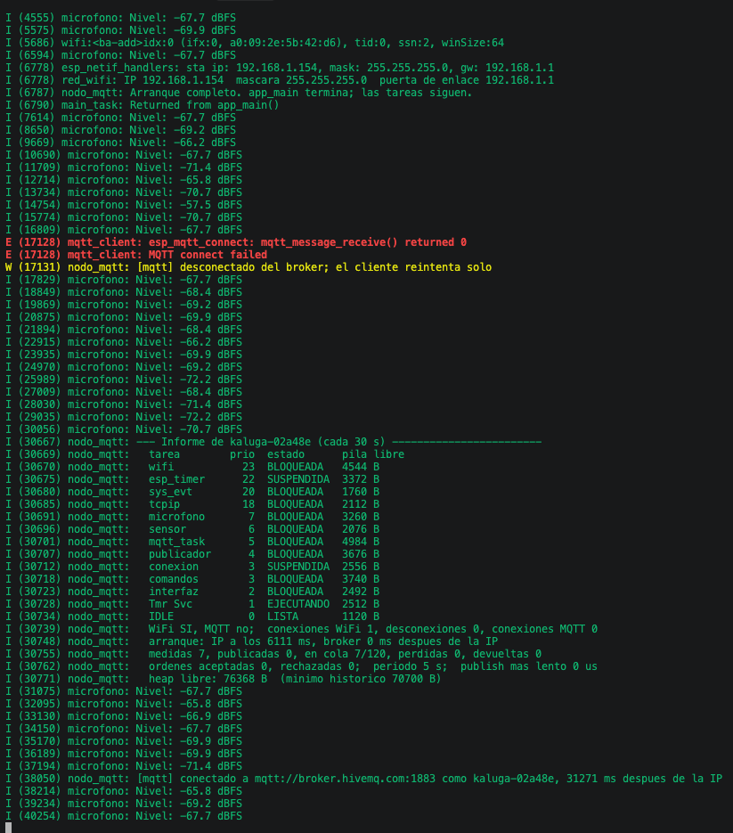
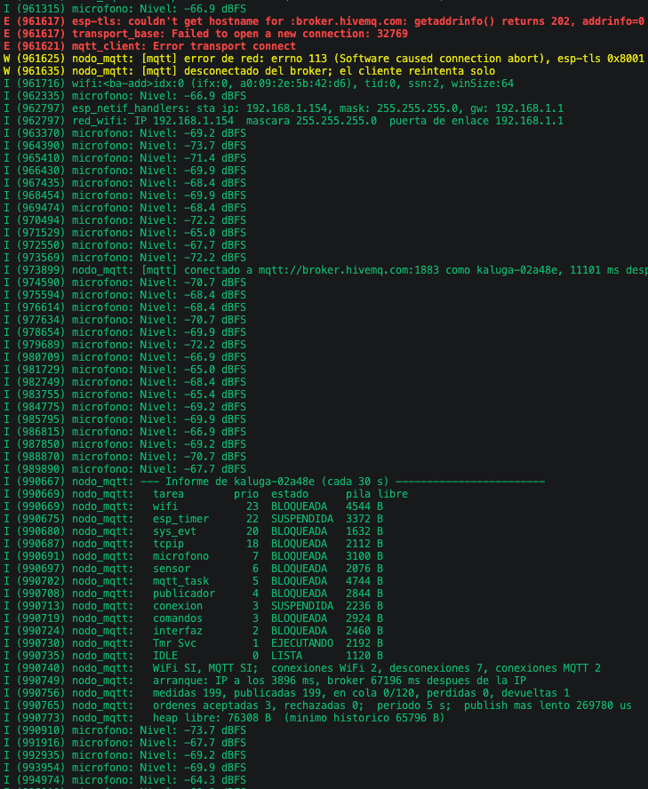
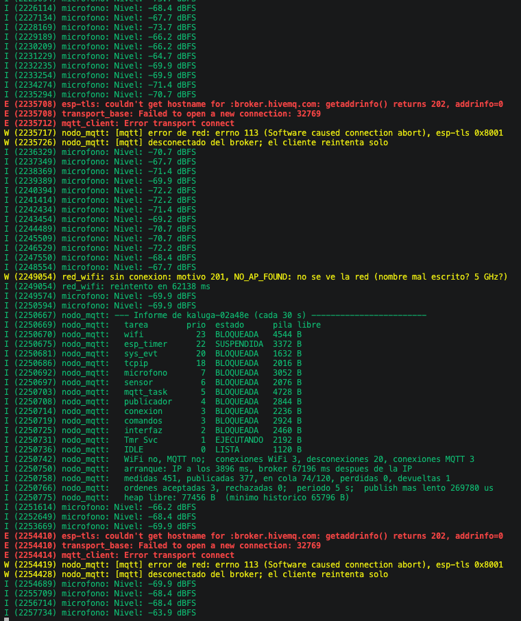
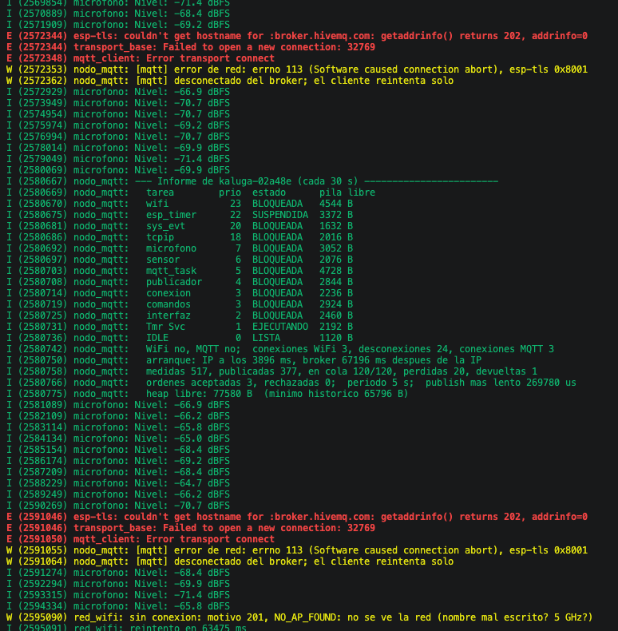
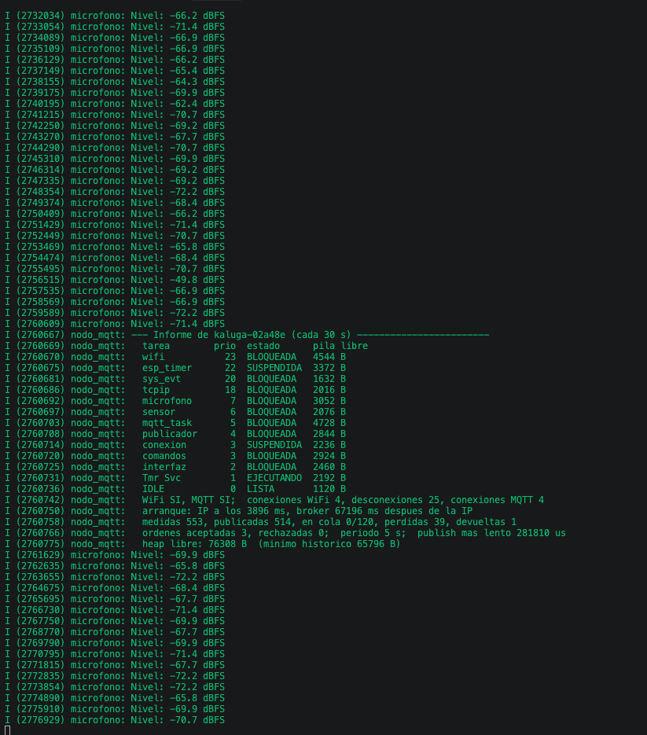
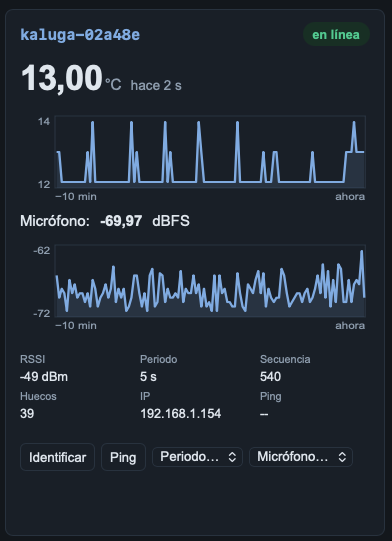
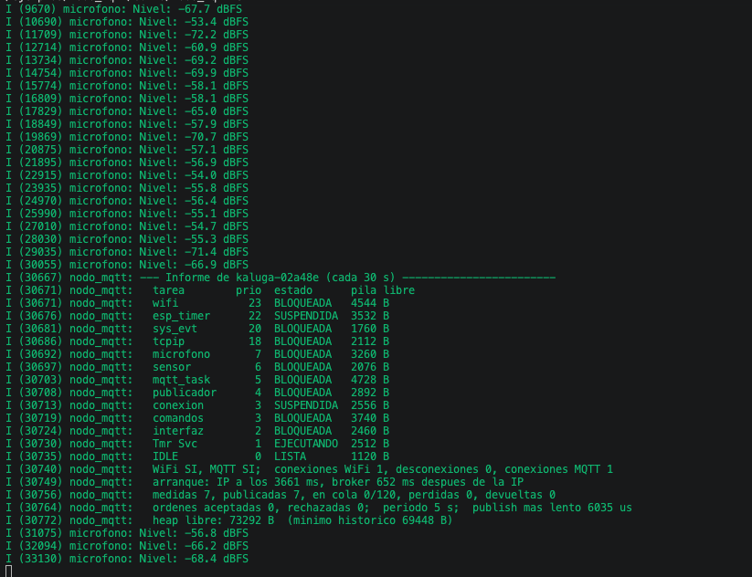

# App 6: El nodo IoT

## 1. Objetivo

Extender el ejemplo `nodo_mqtt` y su `panel_web` de la Clase 6 para construir un nodo IoT que:

- Se conecte por WiFi y publique la **temperatura interna del ESP32-S2**.
- Incorpore una segunda magnitud: el **nivel del micrófono ES8311 en dBFS**, reutilizado de la App 5.
- Muestre las dos magnitudes y sus gráficas de los últimos diez minutos en el panel web.
- Acepte una orden MQTT nueva para **activar/desactivar la publicación del micrófono**, con validación y confirmación en el estado.
- Continúe midiendo durante los cortes de red mediante una cola acotada, con descarte explícito y contadores de pérdidas.

La implementación conserva la estructura y la lógica general del ejemplo del docente. No se agregaron grabación de audio, reproducción ni funciones extra que no requiere la consigna.

## 3. Estructura del proyecto

```text
app6-el-nodo-IoT/
├── README.md                       ← este informe
├── fotos/                         ← capturas de las pruebas
├── ejemplos/
│   ├── nodo_mqtt/
│   │   ├── CMakeLists.txt
│   │   ├── sdkconfig.defaults
│   │   └── main/
│   │       ├── CMakeLists.txt
│   │       ├── idf_component.yml
│   │       ├── nodo_mqtt_main.c
│   │       ├── red_wifi.c
│   │       ├── red_wifi.h
│   │       ├── microfono.c          ← agregado para App 6
│   │       └── microfono.h          ← agregado para App 6
│   └── panel_web/
│       └── index.html              ← panel extendido
└── detalles/                       ← documentación del docente
```

### Arquitectura

```text
Temperatura interna ───────────────┐
                                   ├─▶ tarea_sensor (p6) ─▶ cola de 120 muestras
Micrófono ES8311 ─▶ I2S ─▶ tarea    │                             │
                       microfono (p7)                             ▼
                                                    publicador (p4)
                                                           │
                                              WiFi + MQTT disponibles
                                                           │
                                                           ▼
                                                   broker público
                                                           │
                                              ┌────────────┴────────────┐
                                              ▼                         ▼
                                        temperatura                  microfono
                                              └────────────┬────────────┘
                                                           ▼
                                                 panel web (gráficas)

panel ─▶ comando (QoS 1) ─▶ cola de órdenes ─▶ tarea_comandos (p3)
                                                  └─▶ estado confirmado
```

La tarea de captura I2S trabaja separada del publicador para no depender de los retrasos de red. El nivel medido se comparte con `tarea_sensor`, que lo añade a la muestra junto con la temperatura. No se transmite audio ni se almacena una grabación.

## 4. Temas y órdenes MQTT

**Raíz utilizada:** `ucu-se2026`  
**ID de la placa probada:** `kaluga-02a48e`.

| Tema | Dirección | QoS | Retenido | Contenido |
|---|---|---:|---|---|
| `ucu-se2026/<ID>/temperatura` | Placa → panel | 0 | Sí | Temperatura, RSSI, secuencia y edad |
| `ucu-se2026/<ID>/microfono` | Placa → panel | 0 | Sí | Nivel dBFS, secuencia y edad |
| `ucu-se2026/<ID>/estado` | Placa → panel | 1 | Sí | En línea, IP, período y micrófono habilitado |
| `ucu-se2026/<ID>/comando` | Panel → placa | 1 | No | Órdenes de control |
| `ucu-se2026/<ID>/eco` | Placa → panel | 0 | No | Respuesta al ping MQTT |

Ejemplos de publicaciones recibidas durante las pruebas:

```json
{"t":14.00,"rssi":-60,"seq":100,"edad":0}
{"dbfs":-66.96,"seq":100,"edad":0}
```

La secuencia permite detectar saltos en las muestras y `edad` indica cuántos milisegundos esperó cada muestra antes de publicarse. El panel puede ubicar los puntos recuperados en su instante aproximado de medición.

### Nueva orden implementada

- `microfono=0`: deja de **publicar** el nivel del micrófono.
- `microfono=1`: vuelve a **publicarlo**.

Se validan los textos completos; otros valores quedan rechazados. La placa informa el cambio mediante el tema retenido `estado` (`"microfono":0` o `"microfono":1`) y el panel muestra la confirmación. La **captura I2S sigue funcionando** incluso cuando la publicación está desactivada; esto evita reconfigurar el códec al recibir una orden.

También se conservaron las órdenes originales `periodo=N` (1–600 segundos), `identificar` y `ping=XYZ`. Las pruebas de `microfono=0` y `microfono=1` produjeron en el monitor los mensajes de **desactivado** y **activado**, respectivamente.



### Panel web

Se extendió `ejemplos/panel_web/index.html`, sin reemplazar el diseño original. Ahora muestra temperatura, nivel en dBFS, gráficas independientes de diez minutos y el selector de activación del micrófono.





## 5. Decisiones técnicas

**QoS.** Se utilizó QoS 0 para las mediciones de temperatura y micrófono, ya que no requieren una entrega garantizada. Para las órdenes y el estado se utilizó QoS 1, debido a su mayor importancia. Las órdenes no se retienen para evitar su ejecución al reconectar.

**Prioridades.** Se asignó prioridad 7 al micrófono para garantizar la captura continua de audio, prioridad 6 al sensor, 5 a MQTT y 4 al publicador. Las demás tareas tienen prioridades menores para evitar interferencias con las mediciones.

**Cola.** Se configuró una cola de 120 muestras, con un período inicial de 5 segundos, equivalente a 10 minutos de almacenamiento. Cuando la cola se llena, se descartan las muestras más antiguas para conservar las recientes.

**Panel web.** Se configuró para conservar el último valor recibido durante las desconexiones. Al recuperar la conexión, se muestran las mediciones almacenadas y se detectan posibles huecos en las secuencias.

**Limitación de QoS 0.** Este nivel no garantiza la entrega de todos los mensajes. Por este motivo, se compararon las pérdidas registradas por la ESP32 con los huecos detectados en el panel web.

## 6. Mediciones

Todas las tablas siguientes se basan en capturas **reales** de ESP-IDF Monitor y del panel tomadas durante las pruebas. Los tiempos y los contadores no son valores simulados.

### 6.1. Cinco arranques: hasta IP y desde IP al broker

| Arranque | Hasta IP (ms) | IP → broker (ms) | Total (ms) |
|---:|---:|---:|---:|
| 1 | 3.896 | 67.196 | 71.092 |
| 2 | 6.430 | 608 | 7.038 |
| 3 | 5.304 | 109.689 | 114.993 |
| 4 | 5.922 | 699 | 6.621 |
| 5 | 6.111 | 31.271 | 37.382 |
| **Promedio** | **5.533** | **41.893** | **47.425** |

El tiempo hasta IP se mantuvo aproximadamente entre **3,9 y 6,4 s**. La conexión con el broker público fue mucho más variable: **608 ms a 109.689 ms** desde la IP. Algunos arranques requirieron varios reintentos; la cola permitió seguir midiendo durante esa espera.



### 6.2. Ping MQTT: primera red

Red utilizada: **`Antonio2.4`**, red WiFi doméstica de 2,4 GHz. La prueba mide el recorrido **panel → broker → placa → broker → panel** y no es un ping ICMP.

| Intento | Ida y vuelta (ms) |
|---:|---:|
| 1 | 843 |
| 2 | 865 |
| 3 | 806 |
| 4 | 893 |
| 5 | 893 |
| **Promedio** | **860** |

Mínimo: **806 ms**; máximo: **893 ms**. **La prueba en una segunda red quedó pendiente.** Se intentó utilizar el punto de acceso del iPhone, pero el ESP32-S2 no encontró esa red (`NO_AP_FOUND`). No se reportan mediciones inexistentes ni se presenta el requisito de dos redes como completado.

### 6.3. Corte corto de red (aproximadamente 2 minutos)

Se deshabilitó la red WiFi utilizada por el nodo **sin reiniciar la ESP32**. Durante el corte el sensor siguió midiendo y la cola aumentó; después se recuperaron WiFi y MQTT y la cola volvió a cero.

| Indicador | Antes del corte | Después de la recuperación |
|---|---:|---:|
| Generadas | 121 | 199 |
| Publicadas | 121 | 199 |
| Cola | 0/120 | 0/120 |
| Perdidas | 0 | 0 |
| Devueltas | 0 | 1 |

Los tiempos observados desde la pérdida de red hasta recuperar IP y MQTT fueron aproximadamente **151,8 s** y **163,5 s**, respectivamente; incluyen el tiempo adicional de reconexión. En el panel se llegó a observar un contador de 151 huecos, pero **era acumulado** y no se puede atribuir íntegramente a este corte. No se utiliza como pérdida medida de la prueba corta.



### 6.4. Corte largo de red (12 minutos)

Se mantuvo el nodo encendido y se cortó la WiFi durante un intervalo superior a la autonomía teórica de la cola. Los contadores registrados fueron:

| Indicador | Antes | A ~6 min | A ~11 min | IP recuperada, MQTT todavía caído | Estado final |
|---|---:|---:|---:|---:|---:|
| Generadas | 253 | 451 | 517 | 535 | **553** |
| Publicadas | 253 | 377 | 377 | 377 | **514** |
| Cola | 0/120 | 74/120 | **120/120** | **120/120** | **0/120** |
| Perdidas | 0 | 0 | **20** | **38** | **39** |
| Devueltas | 0 | 1 | 1 | 1 | 1 |

La ocupación creció hasta llegar al límite de 120 muestras. A los 11 minutos ya se habían descartado 20; al terminar la recuperación se habían descartado **39**. Se comprobó la consistencia final:

```text
553 generadas = 514 publicadas + 39 perdidas
```

El panel mostró **39 huecos** tras la recuperación, coincidiendo con las **39 pérdidas** registradas por el firmware en esta prueba. Esta correspondencia es evidencia observada, no una garantía de entrega de MQTT QoS 0 en cualquier escenario.

**A los 6 minutos:**



**A los 11 minutos, cola llena:**



**Después de la reconexión, cola vacía:**



**Huecos vistos por el panel:**



### 6.5. Memoria heap y pilas de FreeRTOS

En el informe posterior al corte largo se observó **heap libre de 76.308 B** y un **mínimo histórico de 65.796 B**. Los valores siguientes corresponden a la columna **`pila libre`** del informe de ese mismo momento (margen de pila, no tamaño total reservado).

| Tarea | Prioridad | Pila libre (B) |
|---|---:|---:|
| wifi | 23 | 4.544 |
| esp_timer | 22 | 3.372 |
| sys_evt | 20 | 1.632 |
| tcpip | 18 | 2.112 |
| microfono | 7 | 3.100 |
| sensor | 6 | 2.076 |
| mqtt_task | 5 | 4.728 |
| publicador | 4 | 2.844 |
| conexion | 3 | 2.348 |
| comandos | 3 | 2.924 |
| interfaz | 2 | 2.460 |
| Tmr Svc | 1 | 2.192 |
| IDLE | 0 | 1.120 |

Todas las tareas registradas tenían pila libre positiva en la medición. El mínimo de heap también se mantuvo positivo durante el experimento; esto no reemplaza una prueba de estrés exhaustiva.



## 7. Seguridad mínima y limitaciones

El proyecto conserva y amplía las precauciones del ejemplo del docente:

- WiFi con **mínimo WPA2** en las pruebas.
- Validación del tema, tamaño y contenido de las órdenes; `microfono` solo acepta `0` o `1`.
- Rechazo de órdenes MQTT **retenidas** para evitar ejecuciones antiguas al reconectar.
- Cola de órdenes y procesamiento fuera del manejador de eventos MQTT.
- Validación de identificadores, JSON y rangos numéricos en el panel; actualización del DOM con `textContent`, no `innerHTML`.
- Mensajes y estado retenidos únicamente donde tienen sentido, más última voluntad de desconexión.

## 8. Cómo reproducir el proyecto

1. Conectar la **Kaluga-1**.
2. Abrir en VS Code como proyecto ESP-IDF **`ejemplos/nodo_mqtt/`**; no abrir la raíz del repositorio como proyecto para compilar.
3. Configurar localmente `WIFI_SSID` y `WIFI_CLAVE` en `ejemplos/nodo_mqtt/main/nodo_mqtt_main.c`, sin subir las credenciales reales.
4. Seleccionar el objetivo `esp32s2` y compilar/flashear:
5. Comprobar en Monitor el identificador de placa, IP, conexión MQTT y tema `ucu-se2026/<ID>/microfono`.
6. Abrir `ejemplos/panel_web/index.html` en un navegador con Internet. Seleccionar **HiveMQ** y raíz `ucu-se2026`.
7. Verificar las gráficas, ejecutar `Ping` e `Identificar`, cambiar el período y probar `Micrófono → Desactivar/Activar` observando las confirmaciones.
8. Para reproducir los cortes, **no reiniciar ni cortar la alimentación de la ESP32**: desactivar temporalmente solo la WiFi de 2,4 GHz a la que está asociada y observar los informes cada 30 s. Restaurar la red y comparar cola, pérdidas y huecos del panel.

Si el flasheo falla con `Wrong boot mode detected (0x4)`, apagar/desconectar el equipo antes de separar la placa de audio, flashear la principal y volver a montarlo sin alimentación.

## 9. Conclusiones

Se consiguió extender el nodo MQTT del docente incorporando el **nivel del micrófono de la App 5**, su publicación independiente y la gráfica correspondiente. La nueva orden permite habilitar/deshabilitar la publicación sin afectar la temperatura ni la captura I2S.

Las pruebas de desconexión demostraron por qué es necesario desacoplar muestreo y red: el nodo continuó midiendo cuando el broker no estuvo disponible y recuperó las muestras almacenadas. Cuando la cola se llenó, se preservaron las lecturas más recientes y se registraron **39 descartes**, que también aparecieron como **39 huecos** en el panel al terminar el experimento.
